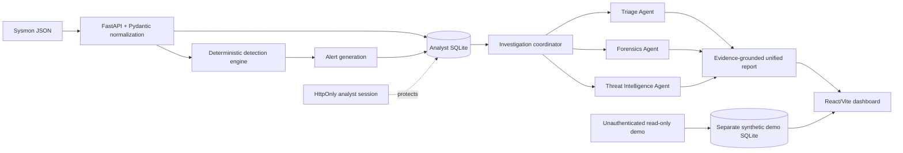

<<<<<<< HEAD
# SHERLOCK — AI-Assisted SOC Investigation Platform

**From Security Telemetry to Evidence-Grounded Investigations.**

SHERLOCK is a security operations investigation platform that combines
deterministic Sysmon detection with specialized AI-assisted triage, forensic
analysis, and threat intelligence workflows. It correlates persisted security
evidence, produces explainable investigation results, and keeps the analyst in
control.

## Security boundary

Unauthenticated public demo access is read-only. Event import and specialist/investigation execution require an analyst session configured through `SHERLOCK_ANALYST_PASSWORD`. See [docs/SECURITY-LIMITATIONS.md](docs/SECURITY-LIMITATIONS.md).

## Release documentation

- [Architecture](docs/ARCHITECTURE.md)
- [Deployment](docs/DEPLOYMENT.md)
- [Demo script](docs/DEMO-SCRIPT.md)
- [Technical decisions](docs/TECHNICAL-DECISIONS.md)
- [Security limitations](docs/SECURITY-LIMITATIONS.md)
- [Interview Q&A](docs/INTERVIEW-QA.md)

## Architecture



The AI services receive only persisted alert-associated evidence. They cannot
execute shell commands, modify the database directly, or perform remediation.
The deterministic detection engine remains authoritative for rule matches.

## Features

- Sysmon-style JSON ingestion with per-record validation errors.
- Raw payload preservation and stable event identifiers.
- Duplicate event and alert prevention.
- Transparent SOC-001 suspicious PowerShell detection.
- SQLite persistence through SQLAlchemy.
- Structured Triage, Forensics, and Threat Intelligence results.
- Evidence-reference validation for event IDs and source fields.
- Deterministic coordinator with ordered execution and partial-failure status.
- React SOC dashboard with alert, investigation, IOC, and event views.
- Local analyst password recovery without a public reset endpoint.

## Screenshots

- [Overview](docs/screenshots/release-overview.png)
- [Security Alerts](docs/screenshots/release-alerts.png)
- [Alert Details](docs/screenshots/release-alert-details.png)
- [Investigation Workspace](docs/screenshots/investigation-workspace.png)
- [AI Agents](docs/screenshots/release-agents.png)
- [Threat Intelligence](docs/screenshots/release-threat-intelligence.png)
- [Event Explorer](docs/screenshots/release-events.png)
- [Settings](docs/screenshots/release-settings.png)
- [Settings mobile viewport](docs/screenshots/release-settings-mobile.png)

## Technology

- Python 3.12
- FastAPI, Pydantic, SQLAlchemy, SQLite
- CrewAI integration for optional configured LLM execution
- React 18, TypeScript, Vite, Tailwind CSS
- React Router, Recharts, Lucide React

## Folder structure

```text
backend/
  app/
    core/          configuration
    persistence/   SQLAlchemy models and repositories
    schemas/       validated API and investigation models
    services/      ingestion, detection, agents, coordinator
  tests/
frontend/
  src/
    components/    reusable dashboard UI
    hooks/         data-loading hooks
    pages/         dashboard routes
    services/      typed API client
    types/         backend response types
data/
  samples/         sanitized simulated Sysmon data
```

## Prerequisites

- Windows 11 PowerShell
- Python 3.12
- Node.js and npm
- Git

## Installation

### Backend

```powershell
Set-Location L:\DOWNLOADS\SOC_Agent
py -3.12 -m venv .venv
& .\.venv\Scripts\python.exe -m pip install -r backend\requirements.txt
```

### Frontend

```powershell
Set-Location L:\DOWNLOADS\SOC_Agent\frontend
npm install
```

## Environment configuration

Copy `.env.example` to `.env` only for local configuration. Never commit real
credentials, API keys, or tokens.

Important backend variables:

- `SHERLOCK_DATABASE_URL`: defaults to the local SQLite database.
- `SHERLOCK_CORS_ORIGINS`: comma-separated trusted browser origins.
- `SHERLOCK_MAX_IMPORT_BYTES`: maximum event import body size; defaults to 5 MiB.
- `SHERLOCK_AUTH_ENABLED`: enables analyst authentication; defaults to `true`.
- `SHERLOCK_ANALYST_USERNAME`: legacy analyst account identifier used for
  password recovery. On first installation, create an administrator through
  the hidden-input CLI bootstrap instead.
- `SHERLOCK_SESSION_TTL_SECONDS`: analyst session lifetime.
- `SHERLOCK_SECURE_COOKIES`: set to `true` when serving over HTTPS.
- `SHERLOCK_LLM_MODEL`: required only when invoking real CrewAI providers.

Provider credentials must be supplied through the provider's documented
environment variables. This repository does not contain or require secrets for
the automated test suite.

## Start the backend

```powershell
Set-Location L:\DOWNLOADS\SOC_Agent\backend
& ..\.venv\Scripts\python.exe -m uvicorn app.main:app --reload --host 127.0.0.1 --port 8000
```

On first installation, create the initial administrator:

```powershell
& ..\.venv\Scripts\python.exe -m app.cli bootstrap-admin --username admin
```

Unauthenticated demo pages remain read-only. Sign in from **Settings** before
importing events or starting an investigation.

Verify:

```powershell
Invoke-RestMethod http://127.0.0.1:8000/health
```

## Start the frontend

In a second PowerShell window:

```powershell
Set-Location L:\DOWNLOADS\SOC_Agent\frontend
npm run dev -- --host 127.0.0.1
```

Open `http://127.0.0.1:5173`.

The Vite development proxy forwards `/health` and `/api` requests to the local
FastAPI server.

## Demonstration workflow

With both servers running, sign in from **Settings** using the configured
analyst credentials. Public demo pages use the separate synthetic database and
cannot import or investigate.

Import the sanitized sample as an authenticated analyst:

```powershell
Set-Location L:\DOWNLOADS\SOC_Agent
$credentials = @{ username = "analyst"; password = $env:SHERLOCK_ANALYST_PASSWORD } |
  ConvertTo-Json
Invoke-RestMethod `
  -Uri http://127.0.0.1:8000/api/v1/auth/login `
  -Method Post `
  -ContentType "application/json" `
  -Body $credentials `
  -SessionVariable session
$sample = Get-Content .\data\samples\sysmon_events.json -Raw
Invoke-RestMethod `
  -Uri http://127.0.0.1:8000/api/v1/events/import `
  -Method Post `
  -ContentType "application/json" `
  -Body $sample `
  -WebSession $session
```

The sample contains:

- One normal PowerShell event that does not alert.
- One encoded-command PowerShell event.
- One multi-indicator PowerShell event.
- One unrelated process event.

View the resulting alerts:

```powershell
Invoke-RestMethod http://127.0.0.1:8000/api/v1/alerts -WebSession $session
```

Run an investigation for the high-severity simulated alert:

```powershell
$alertId = "SOC-001-simulated-003"
$report = Invoke-RestMethod `
  -Uri "http://127.0.0.1:8000/api/v1/alerts/$alertId/investigate" `
  -Method Post `
  -WebSession $session
$report | ConvertTo-Json -Depth 10
```

Retrieve the persisted report:

```powershell
Invoke-RestMethod `
  -Uri "http://127.0.0.1:8000/api/v1/investigations/$($report.investigation_id)" `
  -WebSession $session
```

The three specialist execution statuses, component scoring metrics, evidence
references, findings, and unknown intelligence results are shown from the
backend response and the persisted investigation workspace.

## API summary

- `GET /health`
- `POST /api/v1/auth/login`
- `GET /api/v1/auth/me`
- `POST /api/v1/auth/logout`
- `POST /api/v1/events/import`
- `GET /api/v1/events`
- `GET /api/v1/alerts`
- `GET /api/v1/alerts/{alert_id}`
- `POST|GET /api/v1/alerts/{alert_id}/triage`
- `POST /api/v1/alerts/{alert_id}/forensics`
- `POST|GET /api/v1/alerts/{alert_id}/threat-intelligence`
- `POST /api/v1/alerts/{alert_id}/investigate`
- `GET /api/v1/investigations/{investigation_id}`
- `GET /api/v1/investigations/summary`
- `GET /api/v1/alerts/{alert_id}/investigations`
- `GET /api/v1/validation/rules`
- `GET /api/v1/validation/datasets`
- `POST /api/v1/validation/runs`
- `GET /api/v1/validation/runs`
- `GET /api/v1/validation/runs/{run_id}/report`

## Testing

Backend:

```powershell
Set-Location L:\DOWNLOADS\SOC_Agent\backend
& ..\.venv\Scripts\python.exe -m pytest -q
& ..\.venv\Scripts\python.exe -m compileall -q app tests
```

Frontend:

```powershell
Set-Location L:\DOWNLOADS\SOC_Agent\frontend
npm run typecheck
npm run build
npm audit
```

Automated tests use mocked providers and do not make paid LLM calls.

## Security limitations

The public demo is read-only and uses a separate synthetic SQLite database.
Analyst writes and authenticated reads use the analyst SQLite database.
Authentication uses scrypt password hashes and expiring HttpOnly sessions.
The API has explicit configured CORS origins, request-size limits, security
headers, strict Pydantic validation, evidence-reference validation, and no
shell/remediation capabilities. Model-generated text is rendered as escaped
React text rather than raw HTML.

The current React Router 6 line retains two moderate audit findings. Removing
them requires a React Router 7 migration, which is outside this stabilization
milestone. Vite/PostCSS development dependencies were updated to compatible
secure releases; do not expose the Vite development server publicly.

## Known limitations

- SQLite is intended for the MVP and local demonstration.
- Detection Rule Match Strength, Evidence Completeness, and Threat Assessment
  are exposed as separate report metrics; unknown intelligence is shown as
  insufficient evidence rather than a fabricated percentage.
- Real LLM verification requires a configured provider and credentials.
- The default Threat Intelligence provider is a mock provider.
- Investigation history currently stores one stable current report per alert.
## Operating modes

The backend defaults to `SHERLOCK_AGENT_MODE=demo`. Demo mode uses deterministic,
evidence-backed mock providers and never calls an LLM or external intelligence
service. Set `SHERLOCK_AGENT_MODE=live` and configure `SHERLOCK_LLM_MODEL` to use
the existing CrewAI-backed providers; there is no fallback from live to demo.
Restart the backend after changing the setting. The current mode is available
from `GET /api/v1/runtime/mode` and is shown in the dashboard.
## Detection Validation Lab

Authenticated analysts can run the versioned synthetic SOC-001 validation set from
**Detection Validation Lab**. The lab executes the same deterministic evaluator used
by alert generation, then reports TP, FP, FN, TN, precision, recall, F1, specificity,
and accuracy. Runs are stored as report JSON in a separate validation-history table;
the workflow does not import events, create alerts, invoke agents, or alter detection
rules. Results describe the labelled synthetic set only and are not a claim of
real-world detection performance.
=======
# Sherlock-SOC
AI-assisted SOC platform featuring behavioural threat detection, MITRE ATT&amp;CK mapping, multi-agent investigation, threat intelligence, digital forensics, evidence graphs, attack storyline reconstruction, and detection validation.
>>>>>>> origin/main
