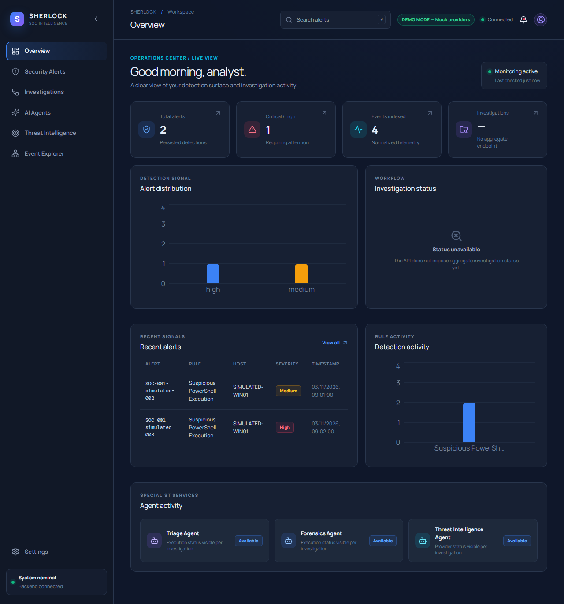
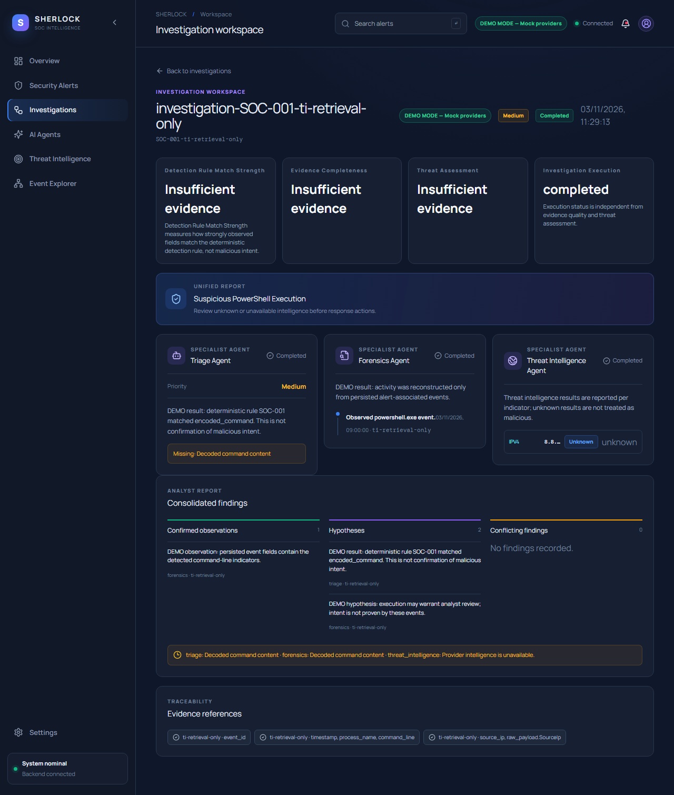
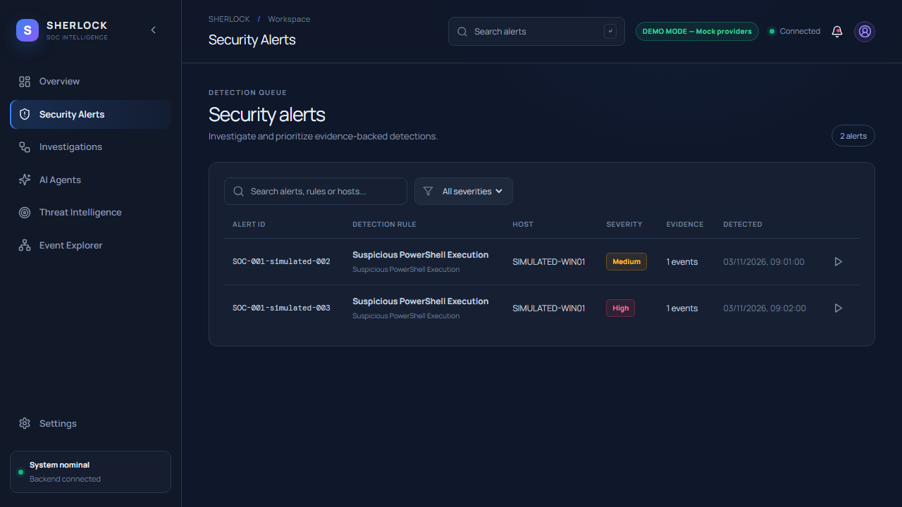
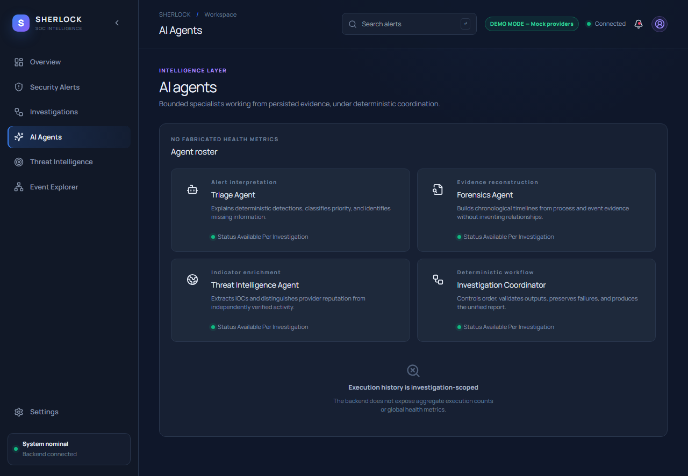
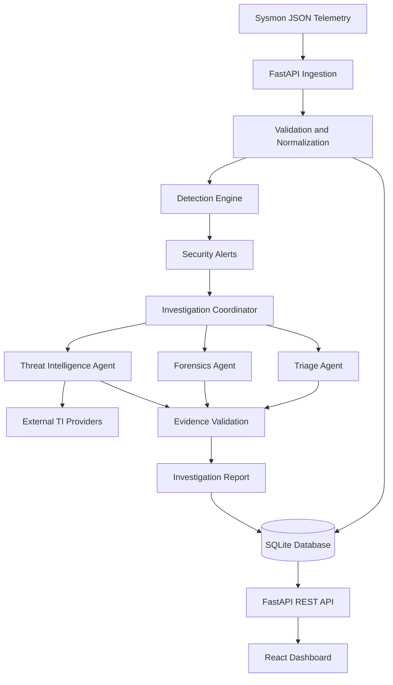

# SHERLOCK SOC
### AI-Assisted SOC Investigation Platform

**A security investigation platform for Windows endpoint telemetry, behavioral detection, and evidence-based alert analysis.**

<p align="center">
  
  
  
  
  
  
  
</p>

SHERLOCK SOC processes Sysmon telemetry, identifies suspicious endpoint activity, and provides analysts with structured investigation reports.

The platform combines deterministic Python detection rules with optional AI-assisted analysis. Its investigation workflow uses Triage, Forensics, and Threat Intelligence components, with evidence validation to check findings against stored telemetry.

The objective is to make alert investigation more structured, traceable, and easier to review.

> **Project status:** Local, single-instance security research prototype. Designed for experimentation and demonstration, not production enterprise SOC deployment.

---

## Screenshots

<p align="center">
  <strong>Operations Dashboard</strong><br>
  
</p>

<p align="center">
  <strong>Investigation Workspace</strong><br>
  
</p>

<p align="center">
  <strong>Security Alerts</strong><br>
  
</p>

<p align="center">
  <strong>AI Investigation Agents</strong><br>
  
</p>

---

## Core Features

| Component | Functionality |
|---|---|
| Telemetry Ingestion | Import, validate, normalize, and store Sysmon JSON events |
| Detection Engine | Identify suspicious process execution and network activity |
| AI-Assisted Investigation | Triage, forensic analysis, and threat-intelligence workflows |
| Evidence Validation | Validate investigation references against stored events |
| Threat Intelligence | Enrich indicators using external reputation providers |
| MITRE ATT&CK | Map detection rules to relevant techniques |
| SOC Workbench | Explore alerts, timelines, evidence relationships, and IOCs |
| Detection Validation | Evaluate detection logic against synthetic test cases |
| Access Control | Local analyst accounts, role-based access, and session management |

## Architecture



Detection and investigation are separate stages. Python rules determine whether an event matches suspicious behavior; the investigation components analyze the resulting alert and its available evidence.

### Technology Stack

| Layer | Technologies |
|---|---|
| Backend | Python 3.12, FastAPI, Uvicorn |
| Validation and ORM | Pydantic 2, SQLAlchemy 2 |
| Frontend | React 18, TypeScript 5.7, Vite 6 |
| Database | SQLite |
| AI Orchestration | CrewAI |
| Styling and Charts | Tailwind CSS, Recharts |
| Threat Intelligence | VirusTotal, AbuseIPDB, AlienVault OTX, GreyNoise, URLhaus |
| Security Framework | MITRE ATT&CK |
| Testing and CI | Pytest, HTTPX, GitHub Actions |

---

## Detection Engineering

SHERLOCK currently implements three behavioral detection rules.

| Rule ID | Detection | MITRE ATT&CK |
|---|---|---|
| SOC-001 | Suspicious PowerShell Execution | T1059.001 |
| SOC-002 | Office Application Spawning Command Shell | T1059.003, T1204.002 |
| SOC-003 | Scripting Interpreter Outbound Connection | T1059.001, T1071.001 |

**Telemetry currently supported:**

- Sysmon Event ID 1 – Process Creation
- Sysmon Event ID 3 – Network Connection

The detection engine evaluates process paths, command-line arguments, parent-child relationships, and associated network activity.

SOC-003 performs correlation between process-creation and network-connection events within the same import batch.

### Detection Validation

The Validation Lab evaluates SOC-001 against 32 labelled synthetic process-creation cases.

It calculates:

- Precision and Recall
- F1-score and Accuracy
- Specificity
- Confusion Matrix

Results can be exported in JSON and Markdown formats.

These measurements represent performance on the project's synthetic dataset, not real-world detection effectiveness.

---

## AI-Assisted Investigation

Investigation is coordinated through a deterministic Python workflow involving three specialist components.

| Component | Responsibility |
|---|---|
| Triage Agent | Reviews alert context and explains detection findings |
| Forensics Agent | Analyzes event relationships and reconstructs timelines |
| Threat Intelligence Agent | Extracts indicators and retrieves reputation information |

The coordinator executes the workflow sequentially, validates structured outputs, tracks execution status, and generates a unified investigation report.

### Evidence Validation

Investigation results are checked against persisted telemetry using:

- Pydantic schema validation.
- Event ID and field-reference validation.
- Process relationship checks.
- Chronological timeline validation.
- Agent execution and failure tracking.

Findings are categorized as observed facts, hypotheses, reputation information, or unknowns.

### Operating Modes

Configure the mode using `SHERLOCK_AGENT_MODE`.

| Mode | Description |
|---|---|
| `demo` | Uses deterministic agent responses without LLM or external threat-intelligence calls. |
| `live` | Enables configured threat-intelligence integrations and optional CrewAI-backed Triage and Forensics analysis. |

If the LLM configuration is unavailable, the relevant agents fall back to deterministic implementations.

AI-generated findings are intended to assist analysts, not replace human investigation or determine detection outcomes.

---

## Threat Intelligence

SHERLOCK supports IOC extraction and reputation enrichment for:

- IPv4 and IPv6 addresses
- Domains and URLs
- MD5, SHA-1, and SHA-256 hashes

### Supported Providers

| Provider | Purpose |
|---|---|
| [VirusTotal](https://www.virustotal.com/) | Multi-engine reputation analysis |
| [AbuseIPDB](https://www.abuseipdb.com/) | IP reputation |
| [AlienVault OTX](https://otx.alienvault.com/) | Threat intelligence pulses |
| [GreyNoise](https://www.greynoise.io/) | Internet scanning context |
| [URLhaus](https://urlhaus.abuse.ch/) | Malicious URL intelligence |

The implementation includes in-process caching, rate limiting, and provider-specific lookup handling.

**Note:** VirusTotal is used for automatic investigation enrichment when configured. The current AbuseIPDB automatic-enrichment integration has a known provider import issue; manual lookup remains available.

---

## Installation and Setup

### Prerequisites

- Windows 10/11
- Python 3.12
- Node.js 20
- npm
- Git

### 1. Clone the Repository

```powershell
git clone https://github.com/lokilokith/Sherlock-SOC.git

cd Sherlock-SOC
```

### 2. Set Up the Backend

```powershell
py -3.12 -m venv .venv

& .\.venv\Scripts\python.exe -m pip install --upgrade pip

& .\.venv\Scripts\python.exe -m pip install -r backend\requirements.txt
```

### 3. Configure Environment Variables

```powershell
Copy-Item .env.example .env
```

Edit `.env` and configure the required settings. External API keys are optional for demo mode.

### 4. Create an Administrator Account

```powershell
cd backend

& ..\.venv\Scripts\python.exe -m app.cli bootstrap-admin --username admin
```

Enter your administrator password when prompted. The password must contain at least 12 characters.

### 5. Start the Backend

Run from the `backend` directory:

```powershell
& ..\.venv\Scripts\python.exe -m uvicorn app.main:app --reload --host 127.0.0.1 --port 8001
```

### 6. Start the Frontend

Open another terminal from the repository root:

```powershell
cd frontend

npm ci

npm run dev -- --host 127.0.0.1
```

### 7. Access the Application

| Service | URL |
|---|---|
| Dashboard | http://127.0.0.1:5173 |
| Backend | http://127.0.0.1:8001 |
| API Documentation | http://127.0.0.1:8001/docs |
| Health Check | http://127.0.0.1:8001/health |

Unauthenticated users are served synthetic demo data. Sign in using the administrator account to access analyst operations.

### 8. Import Sample Telemetry

With the backend running, open PowerShell from the repository root:

```powershell
$base = "http://127.0.0.1:8001"

$creds = @{
    username = "admin"
    password = (Read-Host "Password")
} | ConvertTo-Json

Invoke-RestMethod `
    "$base/api/v1/auth/login" `
    -Method Post `
    -ContentType "application/json" `
    -Body $creds `
    -SessionVariable session | Out-Null

$sample = Get-Content ".\data\samples\sysmon_events.json" -Raw

Invoke-RestMethod `
    "$base/api/v1/events/import" `
    -Method Post `
    -ContentType "application/json" `
    -Body $sample `
    -WebSession $session
```

Imported events are processed by the detection engine. Generated alerts can then be reviewed and investigated through the dashboard.

---

## Configuration

The main environment settings are defined in `.env.example`.

| Variable | Purpose |
|---|---|
| `APP_ENV` | Application environment |
| `SHERLOCK_DATABASE_URL` | Analyst database |
| `SHERLOCK_DEMO_DATABASE_URL` | Demo database |
| `SHERLOCK_AGENT_MODE` | Demo or live mode |
| `SHERLOCK_AUTH_ENABLED` | Authentication control |
| `SHERLOCK_ANALYST_USERNAME` | Analyst username for password recovery |
| `SHERLOCK_SESSION_TTL_SECONDS` | Session expiration |
| `SHERLOCK_SECURE_COOKIES` | Secure cookie configuration |
| `SHERLOCK_LLM_MODEL` | Optional CrewAI model |
| `SHERLOCK_VIRUSTOTAL_API_KEY` | VirusTotal integration |
| `SHERLOCK_ABUSEIPDB_API_KEY` | AbuseIPDB integration |
| `SHERLOCK_OTX_API_KEY` | AlienVault OTX integration |
| `SHERLOCK_URLHAUS_AUTH_KEY` | URLhaus integration |

Additional settings for rate limits, import size, CORS, and login throttling are available in `.env.example`.

Never commit real API credentials or sensitive telemetry.

---

## Testing

### Backend

Run from the backend directory:

```powershell
$env:SHERLOCK_AUTH_ENABLED = "false"

& ..\.venv\Scripts\python.exe -m pytest -q
```

### Frontend

Run from the frontend directory:

```powershell
npm run typecheck

npm run build
```

### CI/CD

GitHub Actions performs backend testing, frontend type checking, and production build validation on pushes and pull requests.

---

## Security and Limitations

SHERLOCK includes local authentication, Scrypt password hashing, server-side session hashes, HttpOnly cookies, login throttling, configurable CORS, and structured investigation validation.

However, the current implementation has important limitations:

- SQLite-based, single-instance architecture.
- Three implemented detection rules.
- Limited cross-event correlation.
- Synthetic-data-based detection validation.
- In-process caching and rate limiting.
- No enterprise SSO, MFA, or multi-tenancy.
- A known authorization gap in alert-lifecycle write endpoints.

Live threat-intelligence lookups may transmit extracted indicators to external providers. LLM-backed investigation may transmit event content, including raw payloads, to the configured model provider.

**Do not expose this prototype to untrusted networks or process sensitive telemetry without appropriate authorization and security review.**

---

## Future Improvements

Planned development includes:

- Expanded Sysmon event coverage and detection rules.
- Cross-batch and host-aware event correlation.
- Improved detection validation datasets.
- Complete threat-intelligence provider integration.
- Stronger API authorization and access controls.
- Persistent caching and database migration support.
- Additional investigation and reporting capabilities.

---

## License

This project is released under the MIT License. See [LICENSE](LICENSE) for details.

**Author:** Lokith Duraisamy

[GitHub](https://github.com/lokilokith) · [LinkedIn](https://www.linkedin.com/in/lokith-cybersec/) · [Portfolio](https://lokith-portfolio-vvnm-two.vercel.app/)
